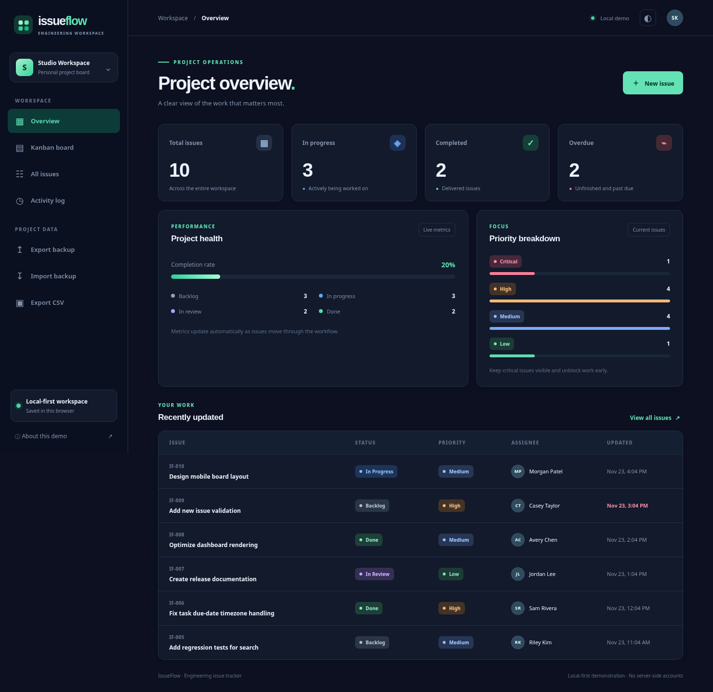
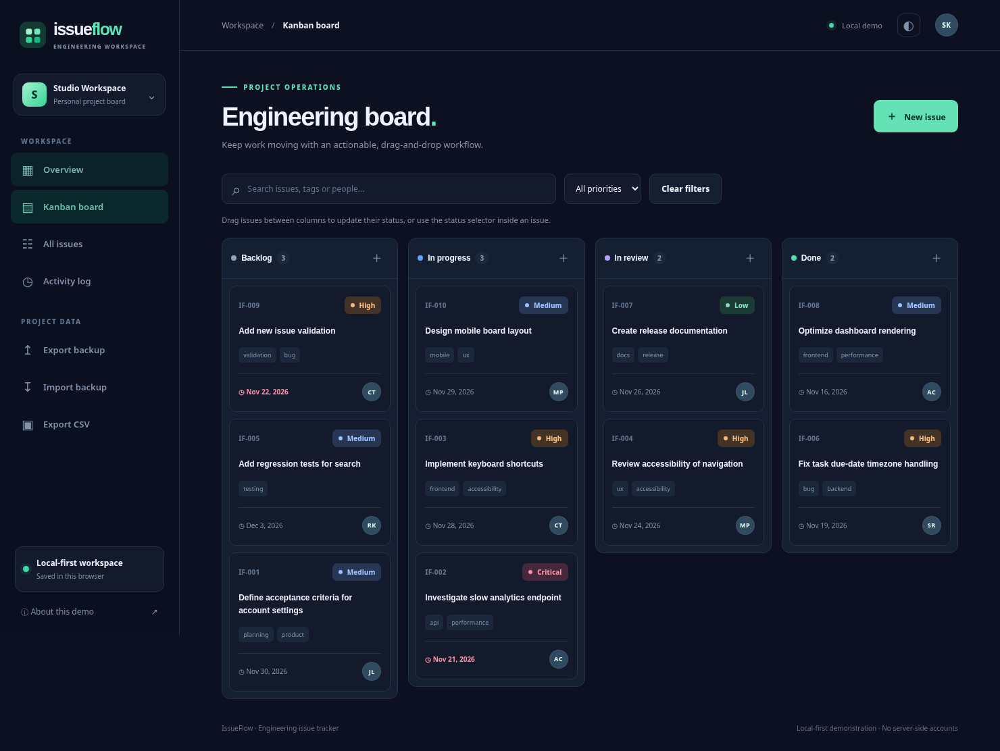

# IssueFlow | Engineering Issue & Project Tracker

**Responsive Kanban boards, practical task management, project health dashboards, optional secure team workspaces, and an installable Progressive Web App.**

**[Live application](https://saikiranbitragunta83-cse-ai.github.io/issueflow-engineering-tracker/)** · [Cloud setup guide](docs/CLOUD_SETUP.md) · [Architecture](docs/ARCHITECTURE.md)



## Features

- Manage tasks and bugs through **Backlog → In progress → In review → Done**.
- Drag and drop issue cards, search and filter by priority, edit assignees, due dates and tags.
- Monitor completion, overdue work, priorities and recent activity.
- **Instant guest demo:** seeded sample issues with local persistence and JSON/CSV export; no account needed.
- **Optional team cloud:** GitHub authentication, PostgreSQL storage, shared workspaces and private invite codes (requires one-time Supabase configuration).
- **Installable web app:** icons and web manifest with offline-capable application shell.
- Accessible interface, responsive design, automated tests and documented deployment/security tradeoffs.



## Stack

| Layer | Technology |
|---|---|
| Frontend | HTML5, CSS3, JavaScript ES modules |
| Guest persistence | Browser localStorage |
| Optional identity | Supabase Auth (GitHub OAuth) |
| Optional cloud persistence | Supabase PostgreSQL and Row Level Security |
| PWA | Web manifest, service worker, install icons |
| Testing | Node.js built-in test runner |
| Hosting | GitHub Pages |

## Run & test locally

```bash
python -m http.server 8000
```

Open `http://localhost:8000/` from the project directory. Run `npm test` with Node.js 20+ to execute the automated tests.

## Deploy

- Upload the repository contents to a public GitHub repository.
- Go to **Settings → Pages → Deploy from a branch → main → /(root)**.
- The guest demo and PWA work without any backend configuration.
- To enable **real cross-device issue synchronization**, use [docs/CLOUD_SETUP.md](docs/CLOUD_SETUP.md) to provision Supabase, run [`supabase/schema.sql`](supabase/schema.sql) and fill in the two **public** values in [`assets/config.js`](assets/config.js). Never publish service_role credentials or OAuth secrets.

## Security and scope

Each cloud workspace is readable and writable only by signed-in members, enforced by database RLS. A valid invite code grants membership, so treat codes privately. Cloud workspaces require an internet connection. The guest demo remains per-browser and its sample records are synthetic. The free Supabase backend can pause after periods of inactivity.

This is a portfolio-oriented engineering application, not an audited enterprise or guaranteed-uptime service. **Cloud collaboration is optional and is not active until the owner configures Supabase.**
